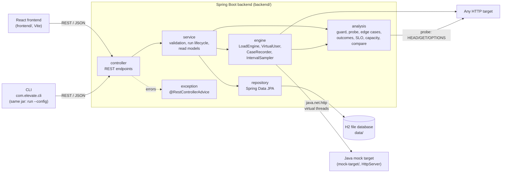
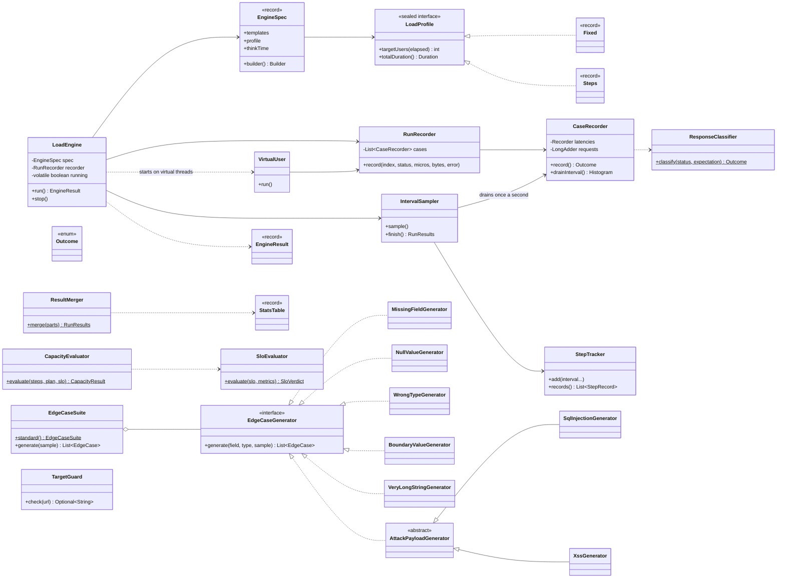
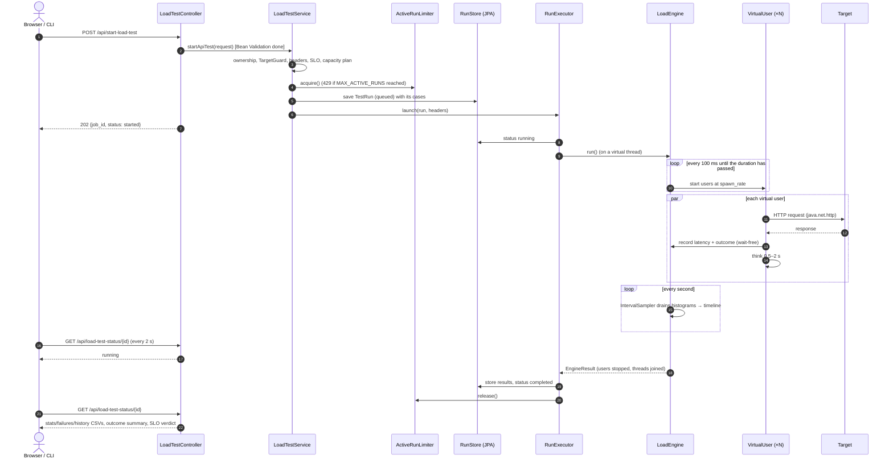
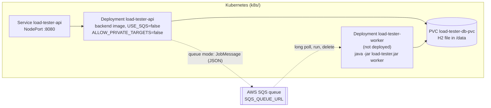
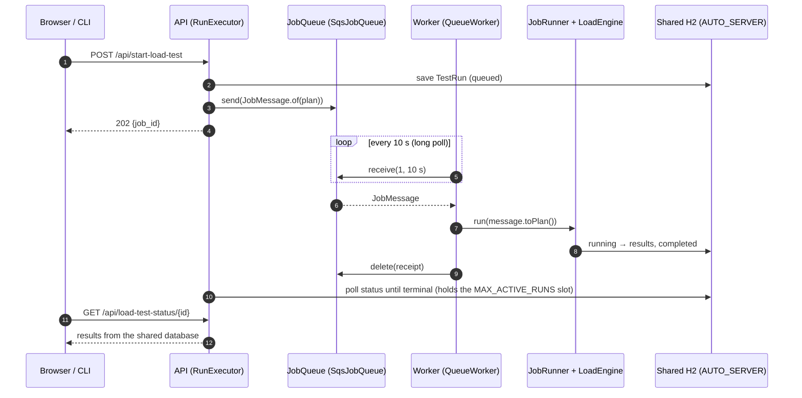

# Architecture

## Components

- The **controller** layer only maps HTTP to service calls; all JSON is snake_case
  (`spring.jackson.property-naming-strategy: SNAKE_CASE`) and every DTO is a record.
- The **service** layer validates requests, stores runs, runs them on virtual threads
  (`RunExecutor`), and builds the read models (`RunViewService`, `BaselineService`,
  `ReportService`).
- The **engine** knows nothing about Spring or JPA: it gets an `EngineSpec` and returns an
  `EngineResult`.
- The **analysis** package is plain Java with no framework dependency: every rule from
  the Python version lives here and is unit-tested directly.

## Engine and analysis classes

## A load test run

A run above 50 users follows the same path with a `SplitGroup`: the executor starts
one engine per child on its own virtual thread, waits for all of them, and the status
endpoint merges the children's histograms. A cancel (`POST /api/cancel/{id}`) calls
`LoadEngine.stop()`: the engine ends at once and keeps the partial results.

## Deployment and queue mode

The default deployment runs load tests inside the API process. Queue mode
(`USE_SQS=true`) is implemented but, as in the Python version, **not deployed**: the
worker manifest and image exist and CI does not apply or build them.

Queue classes (`com.elevate.queue`): `JobQueue` (interface), `SqsJobQueue` (AWS SDK v2),
`JobMessage` (Python's payload keys), `QueueWorker` (poll → run → delete, also on failure),
`WorkerMode` (the `worker` entry point: no web server, queue mode on), `QueueConfig`
(beans only when `USE_SQS=true`). `JobRunner` is shared by local execution and the worker.
